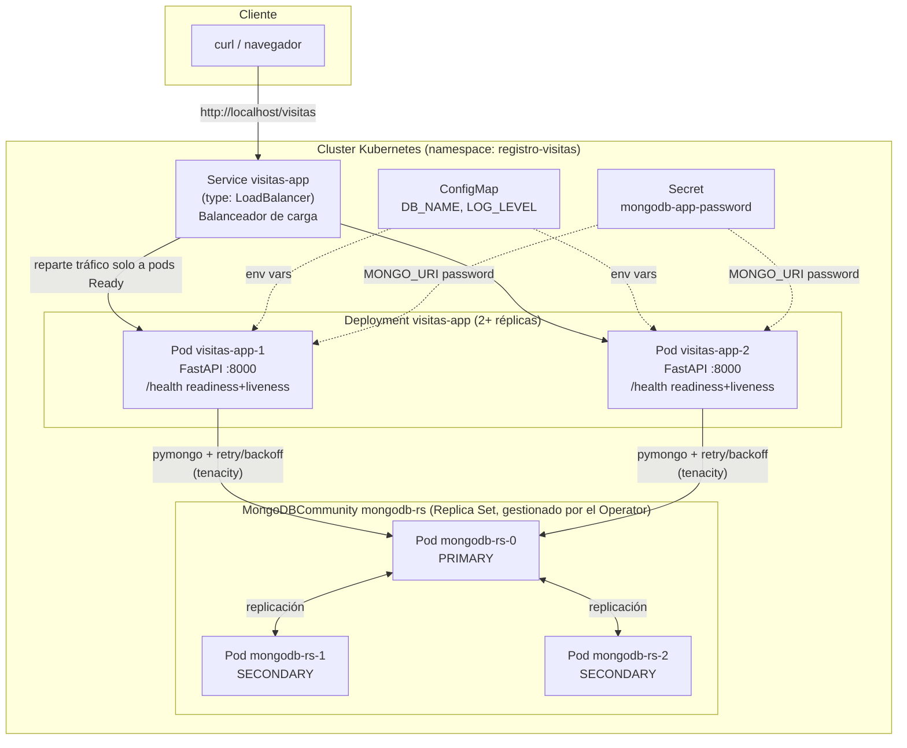

# Project-HA — Registro de Visitas (alta disponibilidad en Kubernetes)

Sistema de registro de visitas con API REST (FastAPI) y MongoDB, desplegado en
**Kubernetes** para demostrar alta disponibilidad (HA):

- **MongoDB Replica Set** de 3 nodos, gestionado por el
  [MongoDB Community Operator](https://github.com/mongodb/mongodb-kubernetes-operator):
  si el primario cae, el operator/replica set elige automáticamente un nuevo primario.
- **2 réplicas de la API** (`Deployment`) detrás de un `Service` tipo `LoadBalancer`:
  Kubernetes redirige el tráfico solo a los pods `Ready` (probe `/health`).
- Reintentos de conexión a Mongo con backoff exponencial (`tenacity`), health-checks
  (`/health`, usados como `readinessProbe`/`livenessProbe`) y logging estructurado en
  JSON con `request_id` por request.

## Objetivo del proyecto (por qué existe esto)

Este repo es un **ejercicio de práctica** de Docker y Kubernetes, no un sistema productivo.
La idea es entender, con un caso simple (un CRUD de visitas), los conceptos que se usan en
casi cualquier despliegue real de alta disponibilidad:

- **Por qué Docker**: empaquetar la API con todas sus dependencias en una imagen
  inmutable, para que corra igual en tu máquina, en el cluster de Kubernetes o en
  cualquier otro lado ("funciona en mi máquina" deja de ser un problema).
- **Por qué Kubernetes**: en vez de correr contenedores "a mano" (como hacía
  `docker compose`), delegarle a un orquestador la tarea de mantener siempre corriendo la
  cantidad de réplicas deseada, reiniciar lo que se cae, y decidir a qué instancia mandar
  cada request. Es el paso natural cuando pasás de "tengo unos contenedores" a "tengo un
  sistema que debe seguir funcionando aunque algo falle".
- **Por qué balanceador de carga**: con 2+ réplicas de la misma API corriendo, necesitás
  algo que reparta las requests entre ellas y que además sepa **dejar de mandarle tráfico**
  a una réplica que está caída o no responde. Eso es lo que hace el `Service` tipo
  `LoadBalancer` de Kubernetes, apoyado en el `readinessProbe`.
- **Por qué MongoDB en Replica Set**: la base de datos suele ser el punto único de falla
  más típico. Un Replica Set (3 nodos, 1 primario + 2 secundarios) permite que si el nodo
  primario se cae, uno de los secundarios sea elegido automáticamente como nuevo primario,
  sin intervención manual y sin perder datos ya confirmados.

En resumen: **Docker resuelve "cómo empaqueto y corro una pieza"**, **Kubernetes resuelve
"cómo mantengo muchas piezas vivas, escaladas y balanceadas"**, y el **Replica Set de
Mongo resuelve la HA del dato**. Las siguientes secciones explican cada pieza del repo y
por qué se armó así.

## Arquitectura



El `Service` es el único punto de entrada visible desde afuera del cluster: reparte cada
request entre los pods de la API que estén `Ready`, sin que el cliente sepa ni le importe
cuántas réplicas hay ni cuál lo atendió. Cada pod de la API se conecta al Replica Set de
Mongo (con reintentos si el nodo elegido no responde); Mongo replica los datos entre sus 3
nodos de forma independiente de Kubernetes, para que un cambio de primario no dependa de la
API.

## Estructura

```
Project-HA/
├── k8s/
│   ├── 00-namespace.yaml          # Namespace registro-visitas
│   ├── 10-mongodb-secret.yaml     # Password del usuario de la app (Secret)
│   ├── 20-mongodb-community.yaml  # CR MongoDBCommunity (replica set de 3 nodos)
│   ├── 30-app-configmap.yaml      # DB_NAME, LOG_LEVEL
│   ├── 40-app-deployment.yaml     # Deployment de la API (2 réplicas) + probes
│   └── 50-app-service.yaml        # Service LoadBalancer
├── app/                     # API FastAPI (sin cambios de código)
│   ├── main.py, db.py, models.py, config.py, logging_config.py
│   ├── routers/visitas.py
│   ├── requirements.txt
│   └── Dockerfile
├── tests/test_visitas.py    # Tests unitarios con mongomock (sin K8s ni Docker)
└── requirements-dev.txt
```

Por qué cada archivo de `k8s/` está numerado y separado (en vez de un único YAML gigante):

- **Orden de aplicación explícito**: los prefijos (`00`, `10`, `20`...) documentan qué debe
  existir antes que qué (el namespace antes que todo, el secret antes que el Mongo que lo
  consume, Mongo antes que la app que se conecta a él). Con `kubectl apply -f k8s/` se
  aplican todos en orden alfabético.
- **Un recurso, una responsabilidad**: separar `Secret`, `ConfigMap`, `Deployment` y
  `Service` en archivos distintos hace más fácil entender (y modificar) cada pieza de
  Kubernetes de forma aislada, algo clave cuando el objetivo es _aprender_ qué hace cada
  tipo de recurso.
- `app/` no cambió respecto a la versión con `docker-compose`: la aplicación en sí no sabe
  ni le importa si corre bajo Docker Compose o Kubernetes — eso es justamente lo que
  demuestra que Docker (empaquetado) y Kubernetes (orquestación) son capas independientes.

## Prerrequisitos

Para llevar este proyecto a otra PC (Windows) hace falta instalar lo siguiente. El orden
importa: Docker Desktop primero, porque WSL2 y el propio Kubernetes dependen de él.

1. **WSL2** (Windows Subsystem for Linux) — requisito de Docker Desktop en Windows.
   Si no está instalado, desde PowerShell como administrador:

   ```powershell
   wsl --install
   ```

   Requiere reiniciar la PC. Windows 10 (build 19041+) o Windows 11.

2. **Docker Desktop** ([docker.com/products/docker-desktop](https://www.docker.com/products/docker-desktop/))
   - Durante la instalación, usar el backend **WSL2** (no Hyper-V).
   - Una vez instalado: **Settings → Kubernetes → Enable Kubernetes** → Apply & Restart.
     Esto instala un cluster de Kubernetes de un solo nodo, listo para usar.
   - Verificar que ambos quedaron activos:
     ```powershell
     docker --version
     docker compose version
     kubectl version --client
     ```

3. **kubectl** — normalmente ya viene incluido al habilitar Kubernetes en Docker Desktop.
   Si no está en el PATH, se puede instalar aparte:

   ```powershell
   winget install -e --id Kubernetes.kubectl
   ```

   Apuntar el contexto activo al cluster de Docker Desktop:

   ```powershell
   kubectl config get-contexts
   kubectl config use-context docker-desktop
   ```

4. **Helm** (gestor de paquetes de Kubernetes, necesario para instalar el MongoDB
   Community Operator):

   ```powershell
   winget install -e --id Helm.Helm
   ```

   Verificar: `helm version`

5. **Python 3.11+** (opcional, solo si querés correr los tests unitarios sin K8s/Docker):

   ```powershell
   winget install -e --id Python.Python.3.12
   ```

6. **Git** (para clonar/traer el proyecto a la otra PC):
   ```powershell
   winget install -e --id Git.Git
   ```

**Requisitos de hardware/SO:**

- Windows 10 64-bit (build 19041 o superior) o Windows 11.
- Virtualización habilitada en la BIOS/UEFI (Docker Desktop la necesita).
- Al menos 8 GB de RAM recomendados (Docker Desktop + Kubernetes + 3 pods de Mongo + 2 de
  la API consumen memoria; con 4 GB puede andar justo).

**Checklist rápido antes de empezar** (correr en PowerShell, todo debería responder sin
error):

```powershell
docker --version
kubectl version --client
helm version
kubectl config current-context   # debe decir: docker-desktop
kubectl get nodes                # debe listar 1 nodo en estado Ready
```

## 1. Instalar el MongoDB Community Operator

**Por qué un operator y no un `StatefulSet` a mano**: un Replica Set de Mongo necesita
pasos de inicialización (`rs.initiate()`), gestión de usuarios/credenciales y lógica de
reconciliación cuando un nodo se cae y vuelve. El _operator_ es un controlador que corre
dentro del cluster y automatiza todo eso: vos declarás "quiero un `MongoDBCommunity` de 3
miembros" (ver `k8s/20-mongodb-community.yaml`) y el operator crea y mantiene el
`StatefulSet`, los `Service` internos y el propio replica set. Se instala una sola vez por
cluster (agrega el CRD `MongoDBCommunity`, es decir un "tipo de recurso" nuevo que
Kubernetes aprende a entender):

```powershell
helm repo add mongodb https://mongodb.github.io/helm-charts
helm repo update
helm install community-operator mongodb/community-operator `
  --namespace mongodb-operator --create-namespace
```

Verificar que el operator quedó corriendo:

```powershell
kubectl get pods -n mongodb-operator
```

## 2. Construir la imagen de la API

**Acá entra Docker**: Kubernetes no sabe compilar código, solo sabe correr _imágenes de
contenedor_. El `Dockerfile` en `app/Dockerfile` empaqueta la API (código + dependencias +
un intérprete de Python) en una imagen autocontenida. Docker Desktop comparte el daemon
Docker local con el cluster de Kubernetes, así que alcanza con construir la imagen
localmente (sin pushear a ningún registry externo): el cluster ya la puede ver.

```powershell
cd "c:\Users\d78069\Desktop\Archivos\Project-HA"
docker build -t registro-visitas-app:local ./app
```

El `Deployment` (`k8s/40-app-deployment.yaml`) referencia esta imagen por su tag
(`registro-visitas-app:local`) — es el puente entre "lo que construyó Docker" y "lo que
Kubernetes va a correr".

## 3. Aplicar los manifiestos

Cada `kubectl apply` le declara al cluster "quiero que exista esto"; Kubernetes se encarga
de crear los recursos y, de ahí en más, de mantenerlos en ese estado (si algo se cae, lo
recrea solo). Este es el corazón de la diferencia con Docker Compose: en Compose vos
levantás contenedores puntuales, en Kubernetes **declarás el estado deseado** y un
controlador lo reconcilia todo el tiempo.

```powershell
kubectl apply -f k8s/00-namespace.yaml
kubectl apply -f k8s/10-mongodb-secret.yaml
kubectl apply -f k8s/20-mongodb-community.yaml
kubectl apply -f k8s/30-app-configmap.yaml
kubectl apply -f k8s/40-app-deployment.yaml
kubectl apply -f k8s/50-app-service.yaml
```

Qué hace cada uno (y por qué existe):

- **`00-namespace.yaml`**: aísla todos los recursos de este proyecto bajo
  `registro-visitas`, para no mezclarlos con otras cosas del cluster y poder borrar todo
  de un saque al final (`kubectl delete namespace`).
- **`10-mongodb-secret.yaml`**: el password de Mongo no se hardcodea en el `Deployment` ni
  en el `MongoDBCommunity` — se referencia un `Secret`. Es la forma estándar de Kubernetes
  de separar credenciales de la configuración/manifiestos versionados.
- **`20-mongodb-community.yaml`**: acá se declara el Replica Set de 3 nodos. El operator
  lee este recurso y crea por debajo un `StatefulSet` (los `Pod` de un `StatefulSet`, a
  diferencia de un `Deployment`, tienen identidad estable — `mongodb-rs-0`, `-1`, `-2` — y
  almacenamiento persistente propio, algo que una base de datos necesita y una API sin
  estado no).
- **`30-app-configmap.yaml`**: configuración no sensible (`DB_NAME`, `LOG_LEVEL`) separada
  de la imagen de Docker, para poder cambiarla sin reconstruir la imagen.
- **`40-app-deployment.yaml`**: acá se declara "quiero 2 réplicas de la API corriendo
  siempre". Un `Deployment` es el recurso pensado para apps _sin estado_ (a diferencia de
  un `StatefulSet`): los pods son intercambiables, cualquiera puede atender cualquier
  request. Incluye los `readinessProbe`/`livenessProbe` sobre `/health`, que son la señal
  que usa Kubernetes (y el balanceador) para saber si un pod está listo para recibir
  tráfico o si hay que reiniciarlo.
- **`50-app-service.yaml`**: **este es el balanceador de carga**. Ver la sección siguiente.

Esperar a que todo quede `Running`/`Ready` (el replica set tarda un par de minutos en
inicializarse la primera vez):

```powershell
kubectl get pods -n registro-visitas -w
```

Deberías ver 3 pods `mongodb-rs-0/1/2` y 2 pods `visitas-app-*` en estado `Running`.

## El balanceador de carga (`Service` tipo `LoadBalancer`)

Esta es la pieza que resuelve "tengo 2 réplicas de la API, ¿a cuál le mando cada request?":

- Un `Service` en Kubernetes **no apunta a un pod puntual**, sino a un `selector`
  (`app: visitas-app`). Internamente mantiene la lista de IPs de todos los pods que
  matchean ese selector y **están `Ready`** (pasaron el `readinessProbe`).
- El tipo `LoadBalancer` le pide además al proveedor del cluster (en Docker Desktop, el
  propio Docker Desktop) que exponga ese Service afuera, en `localhost`. En un cloud real
  (AWS/GCP/Azure) esto crearía un load balancer administrado del proveedor; localmente es
  simulado por Docker Desktop.
- El reparto de tráfico entre los pods sanos es automático: si un pod muere o deja de
  responder el health-check, el `Service` dejar de enviarle tráfico **sin que la app ni
  vos tengan que hacer nada** — es la misma idea que cumplía Nginx con `least_conn` en la
  versión anterior con Docker Compose, pero ahora nativa de Kubernetes.

## Probar la API

En Docker Desktop, el `Service` tipo `LoadBalancer` queda disponible en `localhost`:

```powershell
kubectl get svc -n registro-visitas visitas-app
# EXTERNAL-IP: localhost, PORT(S): 80:xxxxx/TCP

curl http://localhost/health

curl -X POST http://localhost/visitas `
  -H "Content-Type: application/json" `
  -d '{"nombre_visitante":"Juan Perez","dni":"20111222333","motivo":"Reunion","area_visitada":"Sistemas","persona_visitada":"Maria Lopez"}'

curl http://localhost/visitas
curl "http://localhost/visitas?estado=en_curso"
curl -X PATCH http://localhost/visitas/<id>/salida
```

Documentación interactiva: `http://localhost/docs`.

Si el `EXTERNAL-IP` queda en `<pending>`, usar en su lugar:

```powershell
kubectl port-forward -n registro-visitas svc/visitas-app 8080:80
# y probar contra http://localhost:8080
```

## Demostrar la alta disponibilidad

Esta sección es el objetivo práctico del proyecto: **romper cosas a propósito** y ver cómo
el sistema se recupera solo, sin intervención manual.

**1. Failover de MongoDB** (matar el pod primario):

Por qué funciona: el `StatefulSet` que administra el operator garantiza que siempre haya 3
pods (si borrás uno, Kubernetes lo recrea con la misma identidad `mongodb-rs-0` y el mismo
volumen de datos). Mientras tanto, el protocolo de replica set de Mongo (independiente de
Kubernetes) detecta que el primario no responde y promueve a uno de los secundarios.

```powershell
kubectl get pods -n registro-visitas -l app=mongodb-rs-svc  # o revisar rs.status()
kubectl delete pod mongodb-rs-0 -n registro-visitas

# El StatefulSet lo recrea solo; mientras tanto el replica set reelige primario.
# La API sigue respondiendo (puede haber una breve pausa de segundos):
curl http://localhost/visitas
```

**2. Failover de la API** (matar una réplica):

Por qué funciona: el `Deployment` garantiza que siempre haya 2 réplicas del pod
`visitas-app`; al borrar una, Kubernetes crea una de reemplazo. Mientras el pod nuevo
arranca (y hasta que pasa el `readinessProbe`), el `Service`/balanceador ya dejó de
mandarle tráfico al pod caído y lo concentra en el que sigue sano — por eso el usuario no
nota el corte.

```powershell
kubectl get pods -n registro-visitas -l app=visitas-app
kubectl delete pod <uno-de-los-pods-visitas-app>

# El Deployment lo recrea; mientras tanto el Service sigue enrutando al pod restante:
curl http://localhost/health
curl http://localhost/visitas
```

**3. Escalar réplicas de la API** (ver el balanceador sumar un destino más en caliente):

```powershell
kubectl scale deployment visitas-app -n registro-visitas --replicas=3
```

Apenas el nuevo pod pasa el `readinessProbe`, el `Service` empieza a mandarle tráfico
también a él, sin reiniciar nada ni tocar configuración de balanceo — a diferencia de
Nginx (donde había que listar cada backend a mano en `nginx.conf`), acá el balanceador
sigue automáticamente al `selector` del `Deployment`.

## Correr los tests unitarios (sin K8s ni Docker)

Los tests usan `mongomock` para simular MongoDB. Por qué importa que esto **no** dependa de
Docker ni de Kubernetes: la lógica de negocio de la API (crear/listar/cerrar visitas) es
independiente de dónde y cómo se despliega — se puede validar en segundos con un runner de
tests, sin levantar un cluster completo. Separar "pruebo la lógica" de "pruebo el
despliegue" es una buena práctica que también vale la pena practicar.

```powershell
py -m venv .venv
.venv\Scripts\pip install -r requirements-dev.txt
.venv\Scripts\python -m pytest -v
```

## Apagar todo

Borrar el namespace elimina en cascada todo lo que se creó dentro de él (pods,
`Deployment`, `Service`, `Secret`, `ConfigMap`, y el `MongoDBCommunity` con su
`StatefulSet` y volúmenes) sin tener que desandar manifiesto por manifiesto:

```powershell
kubectl delete namespace registro-visitas
# (opcional) desinstalar el operator:
helm uninstall community-operator -n mongodb-operator
```

## Notas de diseño

- El usuario `appuser`/password vienen de un `Secret` (`k8s/10-mongodb-secret.yaml`) con
  un password de ejemplo — **cambiarlo** si esto se usa fuera de un entorno personal. Se
  usa un `Secret` (y no una variable directa en el `Deployment`) porque es la forma en que
  Kubernetes separa "credenciales" de "configuración/manifiestos", aunque en este caso de
  prueba el valor esté en texto plano dentro del repo (en un entorno real no se versiona).
- La cadena de conexión (`MONGO_URI`) apunta directo a los 3 pods del replica set vía DNS
  interno (`mongodb-rs-N.mongodb-rs-svc.registro-visitas.svc.cluster.local`), generado por
  el MongoDB Community Operator (headless service `mongodb-rs-svc` + pods `mongodb-rs-0..2`).
  Esto es distinto del `Service` de la API: un _headless service_ (sin `LoadBalancer` ni
  IP propia) le da a cada pod del `StatefulSet` un nombre DNS estable e individual, algo
  que el driver de MongoDB necesita para saber con cuál nodo está hablando (primario o
  secundario) — mientras que la API, al no tener estado, no necesita distinguir pods
  entre sí, solo necesita "alguno que esté sano" (de ahí el `Service` `LoadBalancer` normal).
- Los logs van a stdout en formato JSON (`kubectl logs -n registro-visitas <pod> -f`). Es
  la convención de Kubernetes: los contenedores no deberían escribir a archivos de log
  propios, sino a stdout/stderr, para que el propio `kubectl logs` (o cualquier stack de
  logging centralizado) los pueda recolectar sin configuración extra.
- Sin Ingress: se usa `Service` tipo `LoadBalancer` directo, tal como se pidió — es la
  forma más simple de exponer un balanceador de carga en Kubernetes. Un `Ingress` agrega
  una capa extra (ruteo por host/path, TLS) útil cuando hay varios servicios HTTP detrás de
  una sola entrada, pero no es necesario para practicar el concepto de balanceo en sí.
- `readinessProbe` vs `livenessProbe` (ambos usan `/health` en `40-app-deployment.yaml`):
  el primero decide si el pod **recibe tráfico** del balanceador (si falla, el pod queda
  "vivo" pero aislado del `Service`); el segundo decide si el pod **debe reiniciarse** (si
  falla repetidamente, Kubernetes lo mata y crea uno nuevo). Son la pieza que conecta los
  health-checks de la app con las decisiones de alta disponibilidad del cluster.
